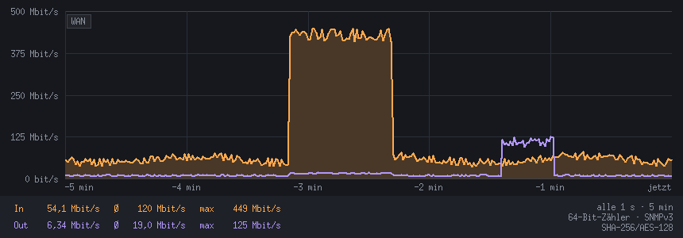
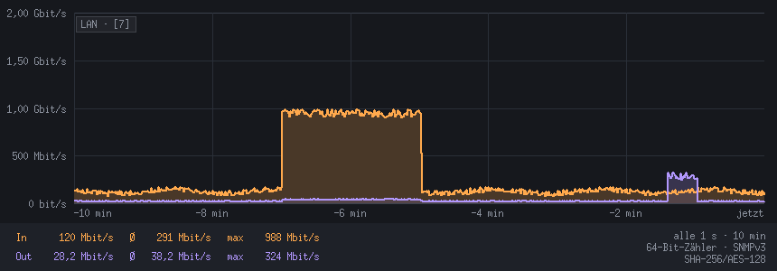
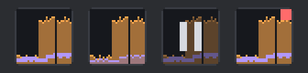
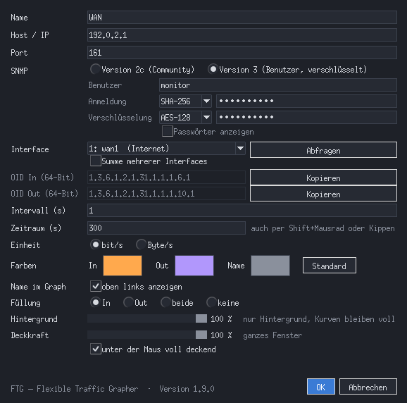

<p align="center"></p>

# FTG – Flexible Traffic Grapher

**Live SNMP traffic graphs for Windows – one window per interface, dark, small, synchronous.**
**Live-Verkehrsgraphen per SNMP für Windows – ein Fenster pro Interface, dunkel, schlank, synchron.**

*Missing **STG – SNMP Traffic Grapher**? FTG is a modern, open-source alternative inspired by the classic.*
*Du vermisst **STG – SNMP Traffic Grapher**? FTG ist eine moderne, quelloffene Alternative nach dem Vorbild des Klassikers.*

[English](#english) · [Deutsch](#deutsch)



---

## English

### What it is
FTG shows the live traffic of a network interface as a graph: incoming and outgoing,
current / average / maximum, refreshed every second. It deliberately keeps no long-term
statistics – just the live view, with the last 60 minutes in memory so you can zoom out or
scroll back. Each window watches one interface (or the sum of several), and you can run as
many windows side by side as you like.

FTG is **one single Python file** using only the standard library – no packages to install.
The user interface is in German.

### Features
- **SNMP v2c and v3** (USM: MD5, SHA, SHA-224/256/384/512; AES-128), 64-bit counters with
  32-bit fallback, counter wrap and reset handling
- **Sum of several interfaces** – e.g. all member ports of a software switch or all access
  ports of a switch, shown as one graph (`LAN · [7]`)
- Graph with selectable fill (In, Out, both, none), current / Ø / max for the visible range
- **60 minutes of history in memory**: zoom the time range (Shift+wheel, wheel tilt, mouse
  side buttons, +/-) and scroll back in time (wheel, arrow keys); pause keeps measuring
- **Synchronous polling** on the system clock – all windows move in step
- **Tray mode** with a tiny live graph as tray icon, borderless mode, always on top
- **Window and background opacity** – e.g. curves only, on a 40 % background
- **Arrange windows** (↓ ↑ → ←) and copy the window size between running windows
- Configurations as JSON, optionally on a network share; SNMPv3 passwords protected with
  Windows DPAPI
- Desktop / autostart shortcuts with FTG's own icon, created from the menu



Tray icons / Tray-Symbole (live graph, both filled, paused, error):



### Requirements
- Windows 10 / 11 (runs with limitations on Linux)
- Python 3.11 or newer from python.org (developed with Python 3.14 / Tk 9),
  e.g. `winget install Python.Python.3.14`
- A device that answers SNMP v2c or v3 (tested with FortiGate and FortiSwitch)
  – e.g. OPNsense / pfSense, OpenWrt, MikroTik, Ubiquiti, Synology / QNAP, managed switches
  (TP-Link, Netgear, HPE …) or Linux / Windows servers with an SNMP service. Many consumer
  routers (e.g. FRITZ!Box) do not offer SNMP.

### Getting started
1. Download `ftg.pyw` from the [latest release](../../releases/latest).
2. Start it: `pythonw.exe ftg.pyw WAN` – without an existing configuration the settings dialog
   opens. Enter host, SNMP version and credentials, click **Abfragen** (query), pick the
   interface, **OK**.
3. Right-click the graph for the menu: more windows, tray mode, arrange windows,
   shortcuts for desktop or autostart.

### Example: SNMPv3 user on a FortiGate
```
config system snmp user
    edit "monitor"
        set security-level auth-priv
        set auth-proto sha256
        set auth-pwd <auth password>
        set priv-proto aes
        set priv-pwd <priv password>
    next
end
```
SNMP must be allowed on the interface you query from (`set allowaccess ... snmp`).
FTG supports `priv-proto aes` (AES-128); `aes256` is not supported.

### Credits – where the idea comes from
FTG is inspired by **STG – SNMP Traffic Grapher by Leonid Mikhailov**, a small, free Windows
tool that gave many administrators in the early 2000s a live view of their links: one window,
one interface, two curves, nothing else. That simplicity is what started this project.
STG's original website no longer exists; FTG contains no STG code.

FTG is a rebuild of the idea, created by *vibe coding* in conversation with Claude on
claude.ai: the requirements, testing and decisions came from the author, the code from Claude.
The result is flexible and modern – SNMPv3, tray mode, sums of interfaces, transparent
overlays, synchronous windows – and still lean: one file, no dependencies. It is meant to be
future-proof because the source is open and runs on current Python versions, free for
everyone under the MIT license.

### License
MIT – see [LICENSE](LICENSE). FortiGate and FortiSwitch are trademarks of Fortinet, Inc.
FTG is not affiliated with Fortinet or with the author of STG.

---

## Deutsch

### Was ist FTG?
FTG zeigt den Live-Verkehr eines Netzwerk-Interfaces als Graph: ein- und ausgehend, aktuell /
Durchschnitt / Maximum, jede Sekunde neu. Eine Langzeitstatistik gibt es bewusst nicht – nur
die Live-Ansicht, wobei die letzten 60 Minuten im Speicher bleiben, damit man herauszoomen
oder zurückblättern kann. Jedes Fenster beobachtet ein Interface (oder die Summe mehrerer),
beliebig viele Fenster können nebeneinander laufen.

FTG ist **eine einzige Python-Datei** und braucht nur die Standardbibliothek – keine Pakete
installieren. Die Oberfläche ist deutsch.

### Funktionen
- **SNMP v2c und v3** (USM: MD5, SHA, SHA-224/256/384/512; AES-128), 64-Bit-Zähler mit
  Rückfall auf 32 Bit, Zählerüberlauf und -reset werden erkannt
- **Summe mehrerer Interfaces** – z. B. alle Mitglieder eines Software-Switches oder alle
  Geräte-Ports eines Switches als ein Graph (`LAN · [7]`)
- Füllung wählbar (In, Out, beide, keine), aktuell / Ø / max für den sichtbaren Ausschnitt
- **60 Minuten Verlauf im Speicher**: Zeitraum zoomen (Shift+Mausrad, Mausrad kippen,
  Maus-Seitentasten, +/-) und zurückblättern (Mausrad, Pfeiltasten); Pause misst weiter
- **Synchrone Abfrage** im Takt der Systemuhr – alle Fenster laufen im Gleichschritt
- **Tray-Modus** mit kleinem Live-Graph als Symbol, Modus ohne Titelleiste, immer im Vordergrund
- **Deckkraft für Fenster und Hintergrund** – z. B. nur die Kurven auf 40 % Hintergrund
- **Fenster anordnen** (↓ ↑ → ←) und Fenstergröße zwischen laufenden Fenstern übertragen
- Konfigurationen als JSON, auf Wunsch auf einem Netzlaufwerk; SNMPv3-Passwörter per
  Windows-DPAPI geschützt
- Verknüpfungen für Desktop und Autostart mit eigenem Symbol, direkt aus dem Menü



### Voraussetzungen
- Windows 10 / 11 (unter Linux eingeschränkt lauffähig)
- Python 3.11 oder neuer von python.org (entwickelt mit Python 3.14 / Tk 9),
  z. B. über UniGetUI oder `winget install Python.Python.3.14`
- Ein Gerät mit SNMP v2c oder v3 (getestet mit FortiGate und FortiSwitch)
  – z. B. OPNsense / pfSense, OpenWrt, MikroTik, Ubiquiti, Synology / QNAP, verwaltete Switches
  (TP-Link, Netgear, HPE …) oder Linux- / Windows-Server mit SNMP-Dienst. Viele Heimrouter
  (z. B. FRITZ!Box) bieten kein SNMP.

### Loslegen
1. `ftg.pyw` aus dem [aktuellen Release](../../releases/latest) herunterladen.
2. Starten: `pythonw.exe ftg.pyw WAN` – ohne vorhandene Konfiguration öffnen sich die
   Einstellungen. Host, SNMP-Version und Zugangsdaten eintragen, **Abfragen** klicken,
   Interface wählen, **OK**.
3. Rechtsklick in den Graph öffnet das Menü: weitere Fenster, Tray-Modus, Fenster anordnen,
   Verknüpfungen für Desktop oder Autostart.

### Beispiel: SNMPv3-Benutzer auf einer FortiGate
```
config system snmp user
    edit "monitor"
        set security-level auth-priv
        set auth-proto sha256
        set auth-pwd <Auth-Passwort>
        set priv-proto aes
        set priv-pwd <Priv-Passwort>
    next
end
```
Am abgefragten Interface muss SNMP erlaubt sein (`set allowaccess ... snmp`).
FTG kann `priv-proto aes` (AES-128), `aes256` wird nicht unterstützt.

### Vorbild und Entstehung
FTG ist inspiriert von **STG – SNMP Traffic Grapher von Leonid Mikhailov**, einem kleinen,
kostenlosen Windows-Programm, mit dem Anfang der 2000er-Jahre viele Administratoren ihre
Leitungen live im Blick hatten: ein Fenster, ein Interface, zwei Kurven, sonst nichts. Genau
diese Einfachheit hat das Projekt angestoßen. Die ursprüngliche Website von STG gibt es nicht
mehr; FTG enthält keinen Code von STG.

FTG ist ein Neubau der Idee, entstanden per *Vibe Coding* im Gespräch mit Claude auf
claude.ai: Anforderungen, Tests und Entscheidungen kamen vom Autor, der Quelltext von Claude.
Herausgekommen ist ein flexibles, modernes Werkzeug – SNMPv3, Tray-Modus, Summen mehrerer
Interfaces, durchsichtige Overlays, synchrone Fenster – das trotzdem schlank geblieben ist:
eine Datei, keine Abhängigkeiten. Zukunftssicher, weil der Quelltext offen liegt und mit
aktuellen Python-Versionen läuft – frei für alle unter der MIT-Lizenz.

### Lizenz
MIT – siehe [LICENSE](LICENSE). FortiGate und FortiSwitch sind Marken der Fortinet, Inc.
FTG steht in keiner Verbindung zu Fortinet oder zum Autor von STG.
